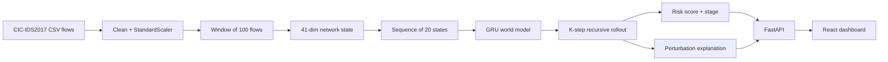

# TRACE — AI World Model for Network Attack Forecasting

> **See what's next & act before escalation.**
> TRACE doesn't just flag anomalies in network traffic. It learns how network behaviour evolves, forecasts the next few time windows, and turns that forecast into a risk score, a likely attack stage, and a feature-level explanation a SOC analyst can act on.


| | |
|---|---|
| **Hackathon** | Smart India Hackathon 2026 |
| **Problem Statement** | SIH26153 — *AI based Network Attack Forecasting from Network Traffic Data* |
| **Theme / Category** | Blockchain & Cybersecurity / Software |
| **Team** | Ativarth (Team ID 1828263) |
| **Demo video** | https://youtu.be/Kny0m7-yNTA?si=scKz3SutCIp7vTVj |

---

## Table of contents

1. [The problem](#1-the-problem)
2. [What TRACE does](#2-what-trace-does)
3. [How it works](#3-how-it-works)
4. [What is built vs. what is planned](#4-what-is-built-vs-what-is-planned)
5. [Repository structure](#5-repository-structure)
6. [Tech stack](#6-tech-stack)
7. [Getting started](#7-getting-started)
8. [Training and evaluating the model](#8-training-and-evaluating-the-model)
9. [Backend API reference](#9-backend-api-reference)
10. [Configuration](#10-configuration)
11. [Frontend dashboard](#11-frontend-dashboard)
12. [Deployment (Vercel)](#12-deployment-vercel)
13. [Real vs. placeholder data](#13-real-vs-placeholder-data)
14. [Known limitations](#14-known-limitations)
15. [ForgeShield OT (separate project in this repo)](#15-forgeshield-ot-separate-project-in-this-repo)
16. [Roadmap](#16-roadmap)
17. [References and datasets](#17-references-and-datasets)
18. [Team, license and acknowledgements](#18-team-license-and-acknowledgements)

---

## 1. The problem

- Attacks evolve faster than traditional detection can respond.
- Early signals are present in network traffic but usually go unnoticed.
- Existing systems detect threats after the fact; they rarely forecast how an attack will progress.
- SOC teams need to know what an attacker is likely to do **next**, not only what already happened.

A typical attack moves through Reconnaissance → Initial Access → Lateral Movement → Exfiltration. Signals such as SYN/ACK/RST flag patterns, inter-arrival times (IAT) and port-scan behaviour appear early in that chain. Traditional detection tends to fire only after the attack goal has been reached.

## 2. What TRACE does

TRACE is an end-to-end pipeline plus a monitoring dashboard:

1. **Unified network state.** Raw flow records are cleaned, normalised and compressed into fixed-size "network state" vectors, one per window of 100 flows.
2. **AI world model.** A GRU learns how these states evolve over time and predicts the next state. Applied recursively, it forecasts K future states.
3. **Predictive threat intelligence.** Each forecast state is scored for deviation from normal behaviour, producing a risk score and a heuristic attack-stage label.
4. **Explainable SOC support.** A perturbation analysis shows which state features most influence the forecast risk.
5. **Dashboard.** A React interface shows current risk, forecast timeline, attack-stage progression, telemetry, explanations, incidents and model health.

**Why it is different:** it forecasts network evolution instead of classifying single flows, it learns dynamics rather than signatures, and every risk number comes with the features that drove it.

## 3. How it works



### 3.1 Data loading and cleaning (`app/data/loader.py`)
- Streams CSVs in chunks (default 200,000 rows), so multi-million-row files never load fully into memory.
- Strips whitespace from column headers, coerces features to numeric, converts `±inf` to `NaN`, drops incomplete rows, casts to `float32`.
- Cleans the label column (replaces a corrupted dash character, trims whitespace).

### 3.2 Feature set (`configs/feature_config.json`)
30 flow-level features, including flow duration, forward/backward packet counts and lengths, bytes/s, packets/s, IAT statistics, PSH/SYN/RST/ACK flag counts, down/up ratio, average packet size, initial window sizes, and active/idle means. Column names live **only** in this file, so swapping datasets means editing one JSON file.

### 3.3 Network state (`app/features/state_builder.py`)
Every non-overlapping window of **100 flows** becomes one state vector of **41 dimensions**:

| Part | Dims | Meaning |
|---|---|---|
| Mean of each scaled feature | 30 | typical behaviour in the window |
| Std of 10 selected features | 10 | variability (e.g. flow duration, bytes/s, IAT) |
| `flow_count` | 1 | always equal to the window size |

The dominant label and attack fraction of each window are kept as metadata for evaluation only. They are never model inputs. Trailing windows smaller than 100 flows are dropped.

### 3.4 World model (`app/models/gru_world_model.py`)
```
input  [batch, 20 states, 41 features]
  → GRU (hidden_size=128, num_layers=1)
  → last hidden output → Linear(128 → 41)
output predicted next state S(t+1)
```
Trained with MSE loss to predict the next state from the previous 20.

### 3.5 K-step rollout (`app/forecasting/rollout.py`)
The model's prediction is appended to the history and fed back in, K times. Each step is validated:
- must have the right dimensionality and be finite (no NaN/Inf),
- must have an L2 norm below `1e4` (catches exploded values).

If a step is unstable, the rollout stops feeding it back, holds the last known-good state for the remaining steps, and returns diagnostics (`stable`, `firstUnstableStep`, per-step norms). Callers always get exactly K predictions, and the API reports unstable steps as `null` instead of scoring a numerical failure as an attack.

### 3.6 Risk score (`app/forecasting/risk_engine.py`, `zscore.py`)
```
z       = (state − baseline_mean) / baseline_std        (per dimension, clipped to ±6)
anomaly = mean(|z|) over active dimensions
risk    = 1 − exp(−0.5 · anomaly)                       ∈ [0, 1]
```
- The baseline is computed from **training** sequences only.
- Near-constant dimensions (std ≤ 1e-3, e.g. `flow_count`) are masked out rather than epsilon-floored, so they cannot saturate the score.
- Non-finite inputs are substituted with the baseline mean (z = 0) rather than scored as maximum anomaly.
- Forecast risk over a horizon is a **weighted average favouring near steps** (weight `0.85^step`); the single worst step is reported separately as `peakRisk`.

> ⚠️ The risk score is a **heuristic anomaly score, not a calibrated probability**. No calibration step exists yet.

### 3.7 Attack-stage mapping (`app/forecasting/stage_mapper.py`)
A rule-based heuristic. The feature group with the largest mean |z| decides the label, provided it exceeds a threshold of 1.0:

| Dominant feature group | Stage label |
|---|---|
| Flow duration / packet counts / bytes/s / packets/s | Denial of Service |
| IAT mean / std | Reconnaissance |
| SYN / RST / PSH / ACK flag counts | Initial Access |
| Backward packet length / backward bytes | Exfiltration |
| Nothing above threshold | Normal / Benign-like |

> ⚠️ This mapping is **illustrative and not scientifically validated.** TRACE does not currently output Lateral Movement or Command & Control stages.

### 3.8 Explainability (`app/explainability/perturbation.py`)
For each of the 41 state features, the most recent state is shifted by +1.0 (scaled units), the model re-predicts, and the change in risk is recorded. The top-K features by |Δrisk| are returned with original value, perturbed value and risk delta. This is a **one-at-a-time sensitivity analysis**, not SHAP.

## 4. What is built vs. what is planned

The project idea deck describes a broader system than the code currently implements. This table is the honest status.

| Capability | Status | Notes |
|---|---|---|
| CIC-IDS2017 CSV ingestion, streaming cleaning | ✅ Built | Chunked, memory-bounded |
| Window → 41-dim network state | ✅ Built | 100 flows per window |
| GRU world model, training script | ✅ Built | PyTorch, early stopping, chronological split |
| K-step forecasting with stability guards | ✅ Built | Horizon 1–20 via API |
| Risk score, horizon-weighted | ✅ Built | Heuristic, uncalibrated |
| Attack-stage prediction | 🟡 Prototype | Rule-based, 4 stage labels |
| Perturbation-based explanation | ✅ Built | Not SHAP |
| FastAPI backend + live-feed simulation | ✅ Built | Replays recorded data on a timer |
| React dashboard (8 pages) | ✅ Built | Mock mode and live mode |
| Evaluation script + logistic-regression baseline | ✅ Built | Flow-level classifier baseline |
| Raw PCAP parsing (Scapy/PyShark) | ❌ Planned | Not in code |
| Isolation Forest anomaly detection | ❌ Planned | Not in code |
| LSTM variant | ❌ Not used | Code uses GRU only |
| SHAP explainability | ❌ Planned | Perturbation used instead |
| MITRE ATT&CK inference | 🟡 UI only | Static illustrative table, not model output |
| NetworkX attack graph / BFS reachability / blast radius | ❌ Planned | Attack-path view is a 3-node placeholder |
| PostgreSQL persistence | ❌ Planned | State is in memory |
| Firewall integration / automated response | ❌ Planned | |
| Real-time live traffic ingestion | ❌ Planned | Dashboard replays a recorded dataset |
| Calibrated probability scoring | ❌ Planned | |

## 5. Repository structure

```
.
├── README.md
├── vercel.json                      # root Vercel config (builds frontend in demo mode)
│
├── trace-backend/                   # Python: ML pipeline + FastAPI service
│   ├── app/
│   │   ├── main.py                  # FastAPI app, CORS, startup (loads model, builds live engine)
│   │   ├── api/
│   │   │   ├── routes.py            # core ML API: /health, /forecast, /rollout, /explain
│   │   │   └── dashboard_routes.py  # dashboard API under /api/*
│   │   ├── core/
│   │   │   ├── config.py            # env-var driven runtime config
│   │   │   ├── schemas.py           # Pydantic request/response models
│   │   │   ├── model_registry.py    # loads checkpoint + scaler
│   │   │   └── live_engine.py       # streams dataset, builds timeline, advances a "live" cursor
│   │   ├── data/loader.py           # chunked CSV streaming + cleaning
│   │   ├── features/
│   │   │   ├── preprocessing.py     # streaming StandardScaler fit (train rows only)
│   │   │   ├── state_builder.py     # windows → state vectors
│   │   │   └── sequences.py         # sliding-window (X, y) sequences
│   │   ├── models/gru_world_model.py
│   │   ├── forecasting/
│   │   │   ├── rollout.py           # K-step rollout + stability diagnostics
│   │   │   ├── zscore.py            # robust masked, clipped z-scores
│   │   │   ├── risk_engine.py       # risk score + horizon weighting
│   │   │   └── stage_mapper.py      # heuristic attack-stage labels
│   │   └── explainability/perturbation.py
│   ├── configs/feature_config.json  # the only file to edit when changing dataset columns
│   ├── checkpoints/
│   │   ├── world_model.pt           # trained GRU + baseline stats + metadata
│   │   └── scaler.pkl               # fitted StandardScaler
│   ├── data/                        # put the dataset CSV here (not included)
│   ├── scripts/
│   │   ├── generate_sample_data.py  # synthetic CICFlowMeter-style data (pipeline validation only)
│   │   ├── inspect_dataset.py       # row counts, NaN/inf counts, label distribution
│   │   └── prepare_real_dataset.py  # schema compatibility check
│   ├── tests/test_pipeline.py       # end-to-end smoke test on synthetic data
│   ├── train.py
│   ├── evaluate.py
│   └── requirements.txt
│
├── frontend/                        # React + Vite dashboard
│   ├── src/
│   │   ├── api/                     # one file per backend resource (mock ↔ real switch lives here)
│   │   ├── hooks/                   # data hooks with loading/error/polling state
│   │   ├── components/              # layout, common, network, forecast, telemetry, explainability, model, overview
│   │   ├── pages/                   # Overview, Network, Forecast, AttackPath, Telemetry, Explainability, Incidents, Model
│   │   └── utils/                   # mockData.js, formatters.js
│   ├── .env.example
│   ├── vercel.json
│   └── tailwind.config.js           # design tokens
│
└── forgeshield-ot/                  # SEPARATE project (PS-27, OT security); see section 15
```

## 6. Tech stack

**Backend / ML:** Python, PyTorch (GRU), scikit-learn (StandardScaler, logistic-regression baseline, metrics), pandas, NumPy, joblib, FastAPI, Uvicorn, Pydantic, psutil.

**Frontend:** React 18, Vite 5, React Router 6, Tailwind CSS 3, Recharts 2, lucide-react.

**Data:** CIC-IDS2017 (cleaned CSV, ~2.57M flows).

## 7. Getting started

### Prerequisites
- Python 3.10+ (recommended; the repo does not pin a version)
- Node.js 18+ and npm
- ~8 GB RAM. No GPU required (the code uses CUDA automatically if available).

### 7.1 Frontend only (no backend, no dataset)
The dashboard runs on mock data by default, so this is the fastest way to see every page.

```bash
cd frontend
npm install
npm run dev          # http://localhost:5173
```

### 7.2 Full stack (real model + real data)

**1. Get the dataset.** The CSV is not included in this repo. Place the cleaned CIC-IDS2017 file at:
```
trace-backend/data/CIC_IDS2017_PS1_Cleaned.csv
```
See [Datasets](#17-references-and-datasets) for the source.

**2. Start the backend.**
```bash
cd trace-backend
python -m venv .venv && source .venv/bin/activate     # Windows: .venv\Scripts\activate
pip install -r requirements.txt
uvicorn app.main:app --reload --port 8000
```
On startup the server loads the checkpoint, streams the dataset once and builds the state timeline. This can take from several seconds to a couple of minutes depending on `TRACE_MAX_ROWS`. Until it finishes, `/api/*` endpoints return `503` with a reason.

Verify:
```bash
curl http://localhost:8000/health
```

**3. Point the frontend at the backend.**
```bash
cd frontend
cp .env.example .env
# edit .env:
#   VITE_DEMO_MODE=false
#   VITE_API_BASE_URL=http://localhost:8000/api
npm install
npm run dev
```

To return to mock data at any time, set `VITE_DEMO_MODE=true`.

### 7.3 Smoke test (no dataset needed)
```bash
cd trace-backend
python tests/test_pipeline.py
```
Generates a tiny synthetic dataset and runs the pipeline end to end (data → states → sequences → GRU → rollout → risk/stage → explanation).

## 8. Training and evaluating the model

### Train
```bash
cd trace-backend

# quick demo on synthetic data
python scripts/generate_sample_data.py --n_rows 20000 --out data/sample_cicids2017.csv
python train.py --mode demo --data data/sample_cicids2017.csv

# inspect and validate the real dataset
python scripts/inspect_dataset.py --path data/CIC_IDS2017_PS1_Cleaned.csv
python scripts/prepare_real_dataset.py --path data/CIC_IDS2017_PS1_Cleaned.csv

# full training (supports multiple CSVs, e.g. the 8 daily files)
python train.py --mode full --data data/CIC_IDS2017_PS1_Cleaned.csv
```

`train.py` options:

| Flag | Default | Meaning |
|---|---|---|
| `--mode` | `demo` | `demo` = 5 epochs, `full` = 20 epochs (override with `--epochs`) |
| `--data` | required | one or more CSV paths (each file is windowed separately so attack/benign transitions don't leak across days) |
| `--config` | `configs/feature_config.json` | feature config |
| `--seq_len` | 20 | states per input sequence |
| `--window_size` | 100 | flows per state |
| `--hidden_size` | 128 | GRU hidden units |
| `--num_layers` | 1 | GRU layers |
| `--batch_size` | 32 | |
| `--lr` | 1e-3 | Adam learning rate |
| `--patience` | 3 | early-stopping patience (epochs) |
| `--chunksize` | 200000 | CSV streaming chunk size |
| `--checkpoint_dir` | `checkpoints` | output directory |

**Training procedure (3 streaming passes):**
1. Count cleaned rows → compute a chronological 85% train cutoff.
2. Fit the `StandardScaler` on **train rows only** (no validation leakage).
3. Build states and sequences, split chronologically 85/15 (no shuffling across the boundary), train with Adam + MSE, keep the best-validation checkpoint.

The checkpoint stores model weights plus everything needed at inference: feature lists, state feature names, baseline mean/std, anomaly mask, `seq_len`, `window_size`, training time, mode and best validation loss. The scaler is saved separately as `scaler.pkl`.

**Bundled checkpoint** (from the files in this repo): input size 41, hidden size 128, 1 GRU layer, sequence length 20, window size 100, trained in `full` mode on 2026-09-18, best validation loss (scaled-state MSE) ≈ 0.1156. This checkpoint predates the stored `anomaly_active_mask` field, so the code derives the mask from `baseline_std` at runtime.

### Evaluate
```bash
python evaluate.py --data data/CIC_IDS2017_PS1_Cleaned.csv
```
Reports:
- **Next-state MAE** over all evaluation sequences.
- **K-step rollout MAE** (default K=5) on up to 200 evenly spaced samples.
- **Logistic-regression baseline** (precision, recall, F1, ROC-AUC) on a bounded 100,000-flow reservoir sample. This is a flow-level classifier trained with labels; TRACE's forecaster is label-free, so the two are not like-for-like.
- **Early-warning lead time:** how many windows before the first ground-truth attack window the risk first crossed 0.5. Measured in **windows of flows**, not wall-clock time, because the dataset has no timestamp column.

> 📌 **Results:** run `evaluate.py` and paste your numbers here. This README intentionally does not quote metrics that were not produced by running the code.
>
> | Metric | Value |
> |---|---|
> | Next-state MAE | _TBD_ |
> | 5-step rollout MAE | _TBD_ |
> | Baseline F1 / ROC-AUC | _TBD_ |
> | Early-warning lead (windows) | _TBD_ |

## 9. Backend API reference

Base URL (local): `http://localhost:8000`. Interactive docs at `/docs` (Swagger UI).

### Core ML API

| Method | Path | Description |
|---|---|---|
| GET | `/health` | liveness check → `{"status":"ok"}` |
| GET | `/model/status/internal` | checkpoint info: `input_size`, `hidden_size`, `seq_len`, `trained_at`, `mode` |
| POST | `/forecast` | K-step forecast → `risk_score`, `forecast_horizon`, `predicted_stage`, `driving_features`, `predicted_states` |
| POST | `/rollout` | raw rollout → `predicted_states`, `per_step_risk` |
| POST | `/explain` | perturbation explanation → `base_risk`, top-K `driving_features` |

Request body for the three POST endpoints:
```json
{ "state_history": [[/* 41 numbers */], /* ...exactly 20 states... */], "K": 5 }
```
`/explain` takes `top_k` instead of `K`. Returns `400` if the history length or state width doesn't match the checkpoint, and `503` if no model is loaded.

### Dashboard API (`/api/*`)

| Method | Path | Description |
|---|---|---|
| GET | `/api/model/status` | model config, device, memory, inference latency, performance snapshot, K-step error |
| GET | `/api/forecast?horizon=5` | horizon 1–20; headline `riskScore` (weighted), `peakRisk`, `modelStable`, per-step states |
| GET | `/api/forecast/risk-timeline` | last 12 observed windows + 5 predicted, for charting |
| GET | `/api/forecast/attack-stages` | observed / current / predicted stage entries (`confidence` is `null`, `confidenceType: "not_calibrated"`) |
| GET | `/api/incidents` | up to 10 most recent attack bursts derived from labelled windows |
| GET | `/api/network/state` | current window: risk, stage, flow/packet/byte counts, raw flow rate and IAT |
| GET | `/api/network/attack-path` | minimal 3-node chain driven by real risk/stage (see §13) |
| GET | `/api/explanations/{forecast_id}` | perturbation explanation for the current window |
| GET | `/api/telemetry` | paginated flow table; params `page`, `pageSize` (≤500), `protocol`, `minRisk` |

Unstable rollout steps return `riskScore: null` and `modelStable: false` rather than a made-up number.

### How the "live" feed works
CIC-IDS2017 is a static recording. `LiveEngine` builds the full state timeline once at startup, then a background task advances a cursor over it every `TRACE_TICK_SECONDS` (default 5 s), looping at the end. The dashboard polls and sees the "current window" move. The model, risk and forecast math on each window are real; the *liveness* is simulated.

## 10. Configuration

All optional environment variables (backend):

| Variable | Default | Purpose |
|---|---|---|
| `TRACE_DATA_PATH` | `data/CIC_IDS2017_PS1_Cleaned.csv` | dataset the live engine streams |
| `TRACE_FEATURE_CONFIG` | `configs/feature_config.json` | feature config path |
| `TRACE_CHECKPOINT` | `checkpoints/world_model.pt` | model checkpoint |
| `TRACE_SCALER` | `checkpoints/scaler.pkl` | fitted scaler |
| `TRACE_MAX_ROWS` | `300000` | rows loaded at startup; `0` = full 2.57M-row file |
| `TRACE_TICK_SECONDS` | `5` | how often the live cursor advances |
| `TRACE_WINDOW_DURATION_SEC` | `5` | nominal seconds per window (used only to pace synthetic timestamps) |
| `TRACE_EVAL_SAMPLE_ROWS` | `20000` | sample size for the one-time Model-page metrics |
| `TRACE_TELEMETRY_SAMPLE_ROWS` | `5000` | rolling per-flow sample kept for the Telemetry page |
| `TRACE_CORS_ORIGINS` | `http://localhost:5173,http://127.0.0.1:5173` | comma-separated allowed origins |

Frontend (`frontend/.env`):

| Variable | Default | Purpose |
|---|---|---|
| `VITE_DEMO_MODE` | `true` | `true` = mock data; `false` = call the backend |
| `VITE_API_BASE_URL` | `http://localhost:8000/api` | backend base URL when demo mode is off |

**Swapping datasets:** edit `configs/feature_config.json` (`label_column`, `timestamp_column`, `selected_features`, `state_std_features`, `default_window_size`, `default_seq_len`). No code changes needed. The cleaned dataset used here has no `Timestamp` column, so `timestamp_column` is `null`.

## 11. Frontend dashboard

Eight pages, one per sidebar item:

| Page | Route | Shows |
|---|---|---|
| Overview | `/` | future risk forecast, attack progression, "why the model forecast this" |
| Network | `/network` | network threat map |
| Forecast | `/forecast` | observed vs. forecast risk timeline, K-step predicted states, state inspector, horizon and estimated lead time |
| Attack Path | `/attack-path` | observed and predicted path segments with evidence |
| Telemetry | `/telemetry` | paginated, filterable flow table with flow detail |
| Explainability | `/explainability` | forecast explanation and MITRE ATT&CK interpretation |
| Incidents | `/incidents` | active/recent incidents with detail |
| Model | `/model` | configuration, resource usage, evaluation metrics, K-step forecast error |

**Architecture:** `pages → hooks → api → (mock | fetch)`. Only `src/api/*.js` knows about endpoints; hooks add loading/error/refresh and polling (network 15 s, forecast 20 s, incidents and model 30 s).

**Observed vs. predicted** is enforced visually everywhere: solid cyan = observed, dashed violet = predicted, plus explicit status badges. Colour is never the only signal; every status also has an icon and a text label.

**Design tokens** (in `tailwind.config.js`): dark theme, cyan accent for analytical/observed data, violet for model forecasts, amber for warning, red for critical, green for healthy.

## 12. Deployment (Vercel)

Both `vercel.json` files build the frontend with `VITE_DEMO_MODE=true`, so a Vercel deployment serves **mock data** and needs no backend. The root config installs and builds from `frontend/`, outputs `frontend/dist`, and rewrites all routes to `index.html` for client-side routing.

To make a hosted frontend talk to a real backend, deploy the FastAPI service somewhere that can hold PyTorch and the dataset (a VM or container host; typical serverless function limits are not a good fit), then:
1. set `VITE_DEMO_MODE=false` and `VITE_API_BASE_URL=https://<your-backend>/api` in the Vercel project environment, **and remove `VITE_DEMO_MODE=true` from the build command**, which currently hard-codes it;
2. add the Vercel domain to `TRACE_CORS_ORIGINS` on the backend.

## 13. Real vs. placeholder data

The backend is explicit about what the dataset can and cannot support.

**Real (computed from the dataset and checkpoint):** state vectors, risk scores, stage labels, K-step forecasts, perturbation explanations, evaluation metrics, packet/byte totals, destination ports, flow durations.

**Derived from ground-truth labels (not model output):**
- *Incidents* are contiguous runs of windows where more than 50% of flows are labelled non-BENIGN. This is a demo-friendly stand-in for incident correlation; it uses labels the model never sees.
- *Early-warning lead time* compares the model's risk crossing 0.5 against the first labelled attack window.

**Placeholder (clearly marked in code):**
- *Attack-path topology:* the cleaned CSV has no source/destination IPs, so the endpoint returns a fixed 3-node chain (External Traffic → Network Perimeter → Monitored Segment) with real risk/stage values.
- *Telemetry identifiers:* source IP, destination IP, source port and protocol are deterministic synthetic values (`_synthetic_identity`). Only destination port is real.
- *Incident affected hosts:* returned as an empty list.
- *MITRE ATT&CK panel:* a static illustrative table, not inferred by the model. Its sample confidence values are shown only in demo mode.
- *Timestamps:* paced from a nominal window duration, not measured capture times.
- *Confidence:* removed (`null`) rather than faked, since no calibration exists.

## 14. Known limitations

- **Risk is uncalibrated.** It is a squashed anomaly z-score, not a probability. Do not read 0.7 as "70% chance of attack".
- **Stage mapping is a heuristic** over four feature groups and is not validated against kill-chain ground truth. CIC-IDS2017 labels attack *types*, not kill-chain stages.
- **Recursive forecasts compound error.** Far-horizon steps are less reliable, which is why the headline risk weights near steps more.
- **No wall-clock lead time.** Lead is measured in windows of 100 flows.
- **Offline only.** There is no live packet capture or PCAP parsing; the "live" view replays a recorded dataset.
- **Single dataset, one checkpoint.** Generalisation to other networks or datasets has not been evaluated.
- **Evaluation baseline mismatch.** The logistic-regression baseline is a supervised flow classifier; comparing it with a label-free forecaster is indicative, not rigorous.
- **Startup cost.** `engine.build()` runs synchronously at startup; with `TRACE_MAX_ROWS=0` this can take minutes.
- **Dataset not bundled.** `data/` contains only a `.gitkeep`.
- **Trailing partial windows** (<100 flows) are dropped.
- **Dependencies are unpinned** in `requirements.txt`.
- **Not security-audited.** Only load checkpoints you trust, since they are deserialised with PyTorch/pickle.

## 15. ForgeShield OT (separate project in this repo)

`forgeshield-ot/` is an unrelated hackathon prototype (**PS-27 — Industrial Cybersecurity Monitoring**) that was committed into the same repository. It is a TypeScript/React frontend for OT (industrial) security monitoring: a Purdue-model topology view, 8 deterministic detection rules mapped to MITRE ATT&CK for ICS, alert-to-incident correlation, and an optional Gemini-assisted investigation view. It has its own README and does not share code or data with TRACE.

```bash
cd forgeshield-ot/frontend
npm install
npm run dev    # http://localhost:5174
npm test       # 15-point verification script
```

> **Recommendation:** move `forgeshield-ot/` to its own repository. Keeping two different problem statements in one repo is confusing for reviewers of the SIH26153 submission.

## 16. Roadmap

- [ ] Publish measured results (forecast error, lead time, baseline comparison) in this README
- [ ] Probability calibration for risk scores
- [ ] Validated attack-stage inference (and Lateral Movement / C2 stages)
- [ ] Real MITRE ATT&CK technique inference
- [ ] Datasets with IPs and timestamps → real host graph, attack paths and blast-radius analysis
- [ ] Raw PCAP ingestion (Scapy/PyShark) and live traffic streaming
- [ ] SHAP-based explanations and comparison against perturbation
- [ ] Persistent storage (PostgreSQL) for forecasts and incident history
- [ ] Alert prioritisation and optional firewall/SOAR integration
- [ ] Cross-dataset evaluation (CIC-IDS2018, UNSW-NB15)
- [ ] Pin dependency versions, add CI and unit tests beyond the smoke test

## 17. References and datasets

**Datasets**
- CIC-IDS2017 — https://www.unb.ca/cic/datasets/ids-2017.html
- BCCC-CIC-IDS2017 — https://www.yorku.ca/research/bccc/ucs-technical/cybersecurity-datasets-cds/intrusion-detection-dataset-bccc-cic-ids2017
- CIC-IDS2018 — https://www.unb.ca/cic/datasets/ids-2018.html
- UNSW-NB15 — https://research.unsw.edu.au/projects/unsw-nb15-dataset

**Papers**
- Sharafaldin et al., *Toward Generating a New Intrusion Detection Dataset and Intrusion Traffic Characterization* (CIC-IDS2017) — https://www.scitepress.org/Papers/2018/66398/ · https://arxiv.org/abs/1804.03599
- Cho et al., *Learning Phrase Representations using RNN Encoder-Decoder* (GRU) — https://arxiv.org/abs/1406.1078
- Ha & Schmidhuber, *World Models* — https://arxiv.org/abs/1803.10122

**Documentation:** [PyTorch GRU](https://pytorch.org/docs/stable/generated/torch.nn.GRU.html) · [FastAPI](https://fastapi.tiangolo.com) · [scikit-learn](https://scikit-learn.org) · [React](https://react.dev) · [Vite](https://vitejs.dev) · [Tailwind CSS](https://tailwindcss.com) · [Recharts](https://recharts.org)

**Context:** [IBM Cost of a Data Breach](https://www.ibm.com/reports/data-breach) · [CERT-In](https://www.cert-in.org.in)

## 18. Team, license and acknowledgements

- **Team Ativarth** — Smart India Hackathon 2026, Team ID 1828263, PS SIH26153.
- **Repository:** https://github.com/antilife-ui/trace-fixed-vercel (the deck links https://github.com/antilife-ui/TRACE.git).
- **License:** _not yet specified._ Add a `LICENSE` file (e.g. MIT or Apache-2.0) before sharing publicly.
- Built on the public CIC-IDS2017 dataset by the Canadian Institute for Cybersecurity.
